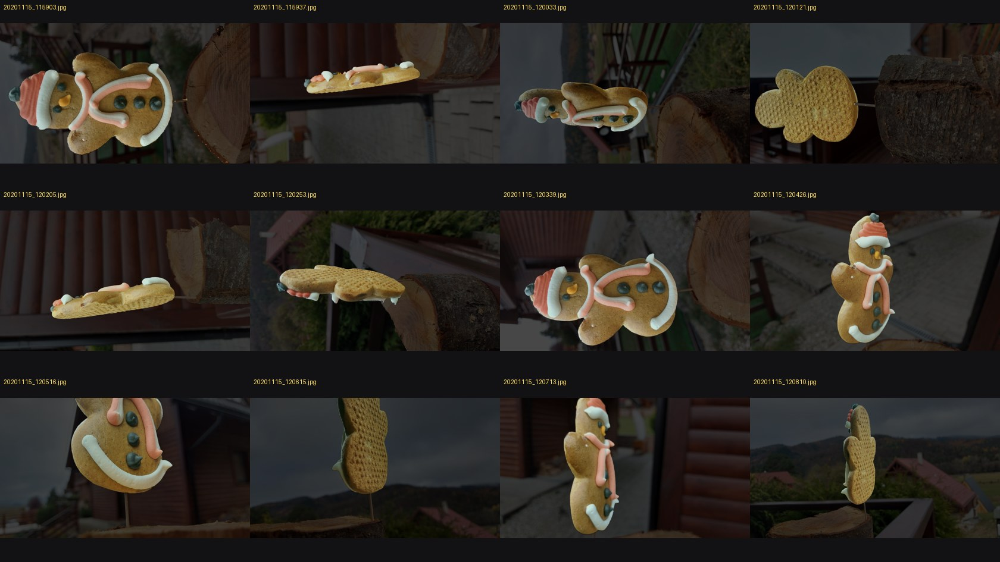
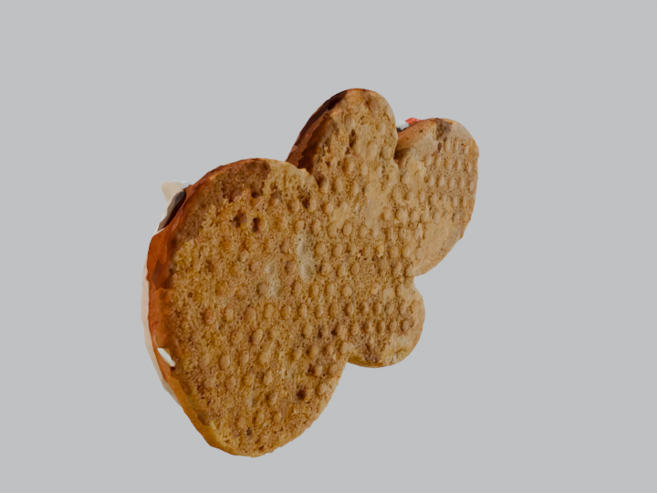
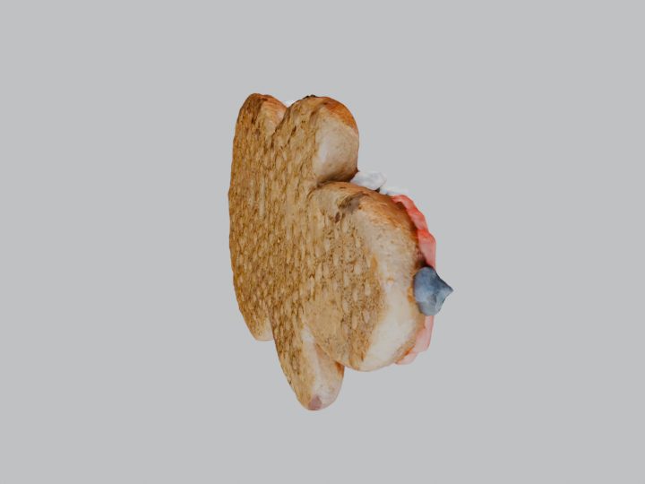

# RESULTS — `gingerbread`

> Every number in this file was measured by the pipeline and read back out of
> `work/<dataset>/.state/*.json`. Nothing here is estimated. Stages that did not
> run are printed as `skipped` with the recorded reason.


## Machine actually used

| | |
|---|---|
| CPU | Intel(R) Core(TM) Ultra 7 155U (14 threads) |
| GPU | Intel(R) Graphics |
| CUDA available | **False** |
| RAM | 31.5 GB |
| OS | Windows 11 |
| torch | 2.13.0+cpu |

## Dataset

| | |
|---|---|
| name | `gingerbread` |
| images | 85 |
| source resolution | 4624x2604 |
| working max dimension | 2000 px |
| camera (EXIF) | samsung SM-A715F ×85 |

## Stage timings

| stage | status | seconds | peak RAM MB | peak VRAM MB | note |
|---|---|---:|---:|---:|---|
| `s0_ingest` | ok | 50.65 | 315.8 | 0.0 |  |
| `s1_masks` | ok | 1210.94 | 3282.2 | 0.0 |  |
| `s2_colmap` | ok | 534.07 | 9155.4 | 0.0 |  |
| `s3_mvs` | ok | 53.78 | 1186.4 | 0.0 |  |
| `s3b_realityscan` | skipped | 0.0 | 0.0 | 0.0 | RealityScan/RealityCapture is not installed on this machine. It is also unusable here: Epic requires a GPU with CUDA Compute Capability 3.5+ (or AMD RDNA 3/3.5/4 since 2.2) to create models or textures, and this box has Intel integrated graphics only. Install + rerun on the CUDA machine to produce the comparison. Citation: https://dev.epicgames.com/documentation/realityscan/hardware-and-software-requirements |
| `s4_cleanup` | ok | 8.08 | 272.0 | 0.0 |  |
| `s5_export` | ok | 43.86 | 1403.0 | 0.0 |  |
| `s5b_render` | ok | 12.33 | 1007.9 | 0.0 |  |

**Total measured wall clock: 1913.71 s (31.9 min)** across stages that ran.


## Sparse alignment: masked vs unmasked

| variant | registered images | of | mean reprojection error px | points | seconds |
|---|---:|---:|---:|---:|---:|
| unmasked | 83 | 85 | 0.8217 | 13872 | 357.64 |
| masked | 60 | 85 | 0.5798 | 4429 | 157.76 |

**Winner used downstream: `unmasked`** — 83/85 images registered, mean reprojection error 0.8217 px; other variant registered [60]


## Path A (COLMAP + OpenMVS) vs Path B (RealityScan)

| | path A | path B |
|---|---|---|
| status | ok | skipped |
| seconds | 53.78 | 0.0 |
| note | resolution-level 2, masked, 369882 tris | RealityScan/RealityCapture is not installed on this machine. It is also unusable here: Epic requires a GPU with CUDA Compute Capability 3.5+ (or AMD RDNA 3/3.5/4 since 2.2) to create models or textures, and this box has Intel integrated graphics only. Install + rerun on the CUDA machine to produce the comparison. Citation: https://dev.epicgames.com/documentation/realityscan/hardware-and-software-requirements |

## Outputs

| artefact | size MB |
|---|---:|
| glb | 0.76 |
| usdz | 7.05 |
| obj | 13.97 |

Final triangle count: **120000**


## Visual checks


**Mask contact sheet (12 evenly spaced frames)**




**Render 1**




**Render 2**




**Render 3**


## What failed or looks bad

- **`s3b_realityscan` — skipped**: RealityScan/RealityCapture is not installed on this machine. It is also unusable here: Epic requires a GPU with CUDA Compute Capability 3.5+ (or AMD RDNA 3/3.5/4 since 2.2) to create models or textures, and this box has Intel integrated graphics only. Install + rerun on the CUDA machine to produce the comparison. Citation: https://dev.epicgames.com/documentation/realityscan/hardware-and-software-requirements
- Texture seams between patches are not blended: OpenMVS v2.4.0 seam-leveling is disabled to work around the black-patch regression (github.com/cdcseacave/openMVS issue #1251, fixed in develop commit eeedab7a, no release yet). On a CUDA machine, use a develop build or v2.3.0 TextureMesh to restore seam blending.

## Reproduce

```
python run.py --dataset gingerbread
```

Viewer: open `viewer/index.html?dataset=gingerbread` in a browser (it loads `outputs/<dataset>/model.glb`).

